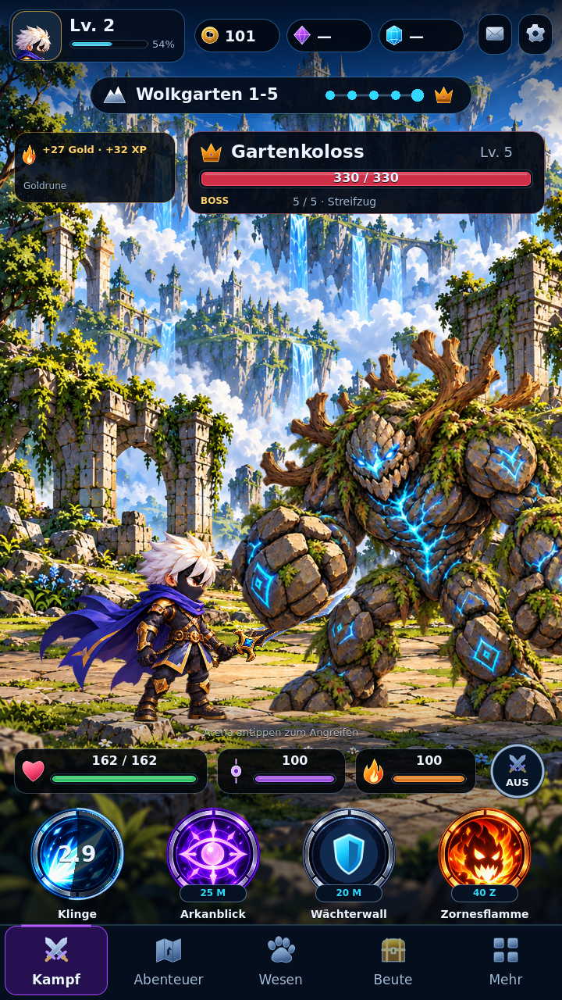
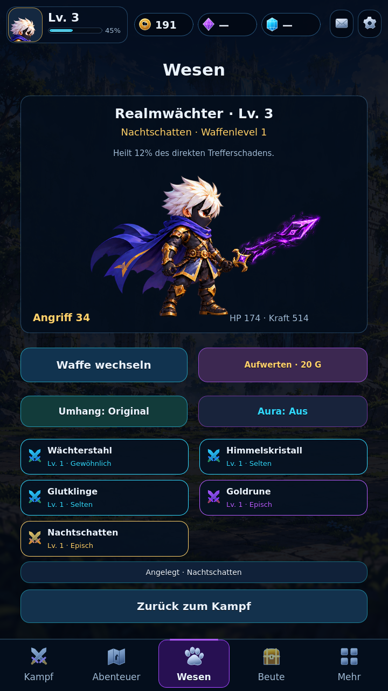
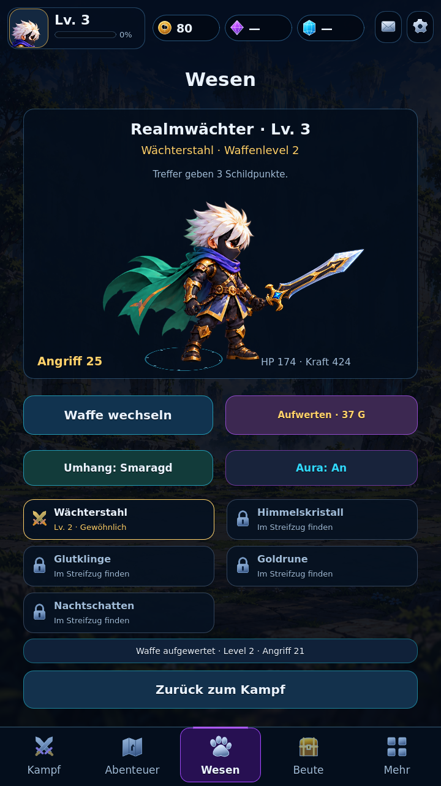
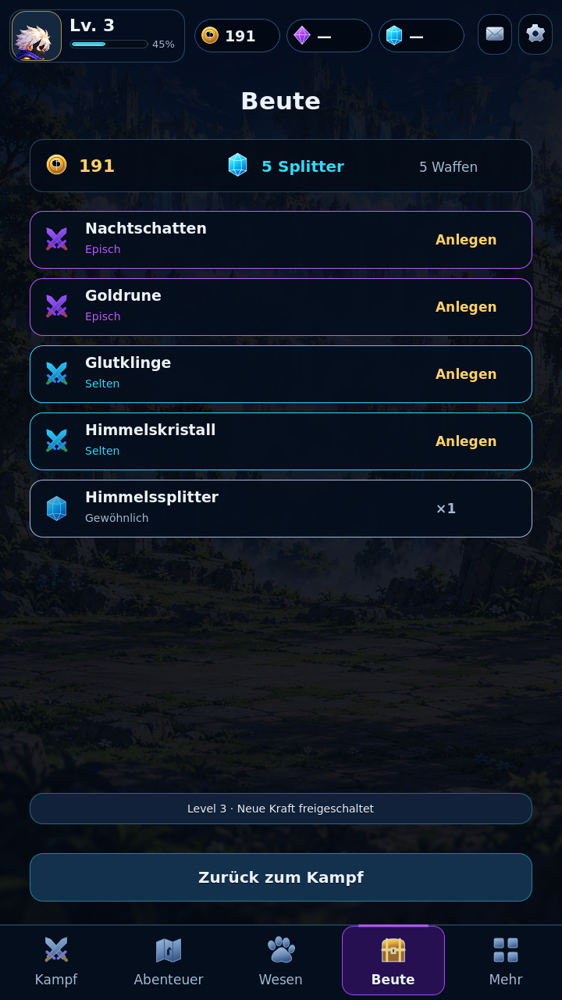
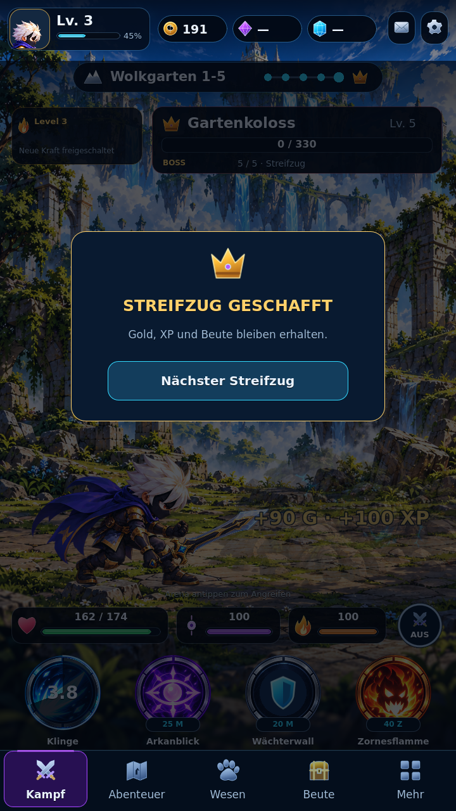
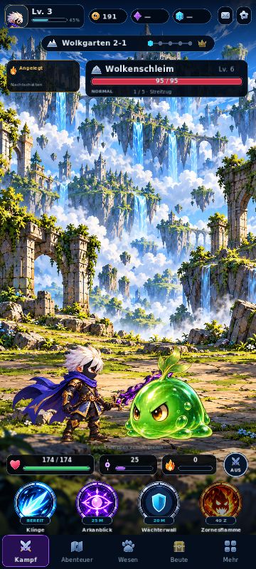

# REALM ALLIANCE — Work 6.2

Runtime: `8f0973bfc17366c4c27a96d811db5de1eac2414e` (Godot 4.7.2). Branch: `feature/work-6-2-combat-progression`. No merge into main or Game Factory.

## Implemented
- Fixed-step combat model separated from input and rendering: SkillDefinition, SkillRuntime, CombatStatus, EnemyBehavior, Equipment, PlayerProgress, RewardSystem, SaveMigration and CombatSession.
- Himmelsklinge: 2.8x direct damage, 5.5s cooldown. Arkanblick: 25 Momentum, 8s cooldown, 0.7x impact and 5s mark (+35% subsequent direct damage). Zornesflamme: 40 Rage, 12s cooldown, 2.5x impact and four 0.4x burn ticks. Guardian shield: unlock level 2, 20 Momentum, 9s cooldown, 4s shield (35% max HP) with one 1.5x counter.
- AUTO uses normal attacks only. Skill costs, unlocks and cooldowns are checked in gameplay, with feedback for rejected inputs.
- Incoming attacks with telegraphs, real player HP, shield absorption, hit/knockback, defeat/restart and victory. Normal, elite double strike and alternating boss heavy strike behaviors.
- Five-encounter run: slime, golem, elite golem, slime, boss. Manual continuation after victory; replay after defeat. Incremental tier scaling.
- Five existing separate swords with stable item IDs, individual upgrades and real guard/crit/burn/Momentum+gold/lifesteal traits.
- Deterministic first-discovery drops with item rarity, shards, XP and gold. Duplicate discoveries yield upgrade material. Idempotent encounter rewards; real loot/equipment views.
- XP-based progression. Legacy kill count is used once to estimate migration XP, never as the ongoing player-level formula.
- Pose-compatible body sockets, separate sword and aura layers. Real emerald cape palette variant and level-3 evolution aura, available on the Hero page. Armor/head/back/wings slots are prepared; full artwork sets are intentionally not implemented.
- New four-state Wolkgarten slime, separate status/impact/activation effects, true mark/burn/shield indicators and differentiated skill movement. Existing canonical hero, golem and Wolkgarten background retained.
- Versioned saves/checkpoints, legacy snapshot, backup/recovery, future-version protection, explicit JSON import/export with confirmation and pre-import backup.

## Automated validation
Successful CI: [run 39067212665](https://github.com/Broosskyy/Realm-Alliance/actions/runs/39067212665), runtime commit above. Web export and Android debug APK both succeeded.

| Suite | Checks |
|---|---:|
| Existing combat | 20 |
| Layout | 32 |
| Visual contract | 11 |
| Fallback art | 46 |
| Production art | 22 |
| Work 6.2 systems | 63 |
| Save migration/storage | 22 |
| Actual scene integration | 67 |
| **Total** | **283** |

Coverage includes costs/rejections, cooldowns, mark amplification/expiry, exactly four burn ticks, shield and single counter, incoming telegraph/damage/death/restart, enemy behaviors, all weapon traits, upgrades/materials, duplicate reward claims, complete manual and AUTO runs, pending-hit weapon snapshots, checkpoint restore, V1 migration/import, real UI navigation, equipment and cosmetics. Disk tests require an isolated realm62-test data directory.

Native rendering and actual scene integration were inspected with Godot OpenGL/Mesa at 720x1280, 720x1560, 360x800 and 1280x720. Captures below are real Godot scenes, not concept mockups. They show combat/mark/boss, victory/defeat, loot and mounted equipment/cosmetics.

Final exported-browser smoke/transfer verification: pending the final delivery check; results will be appended. Physical Android device testing remains open.

## Builds and save safety
Download CI artifacts `realm-alliance-work62-web` and `realm-alliance-work62-android` from the successful run. Serve the extracted Web build over HTTP(S), rather than opening index.html as a local file.

APK: version 0.6.2 / code 62, ARM64, package `com.avenor.realmalliance.preview`, display name REALM ALLIANCE Preview.
APK SHA256: `97f26ea27ede045b6c799cfae8e1405f0f9c5384284dc005911b1bce49fb55eb`.

The earlier Android CI generated disposable signing keys. The preview therefore deliberately installs alongside the old app: **keep the old app installed**. Its private save remains there; a different Android package cannot automatically read it. Existing V1/V2 JSON backups can be imported through More. Obtaining a backup from an old app without an export UI may require device/ADB access; this path has not been device-tested.

A public development-only debug keystore is now committed for consistent preview updates. It is not a production/store signing key. Subsequent preview updates can preserve preview saves.

## Scope and remaining review
Ready for visual/gameplay review, not a production release. Balance is a bounded first pass. One new enemy family has full state artwork; elite/boss golems share canonical art with distinct behavior/indicators. Full armor/head/wings pose sets, randomized loot affixes, online authority and larger systems remain outside this pass. Cosmetic cape/aura examples are real; unused slots are explicitly foundations.

## Actual Godot captures

