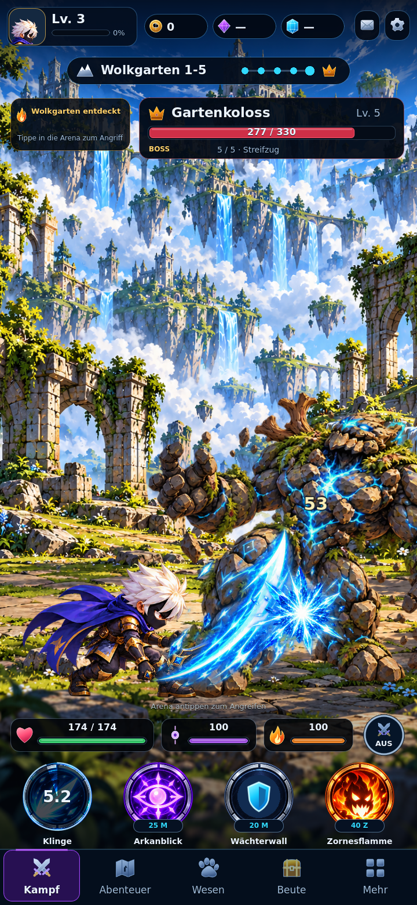
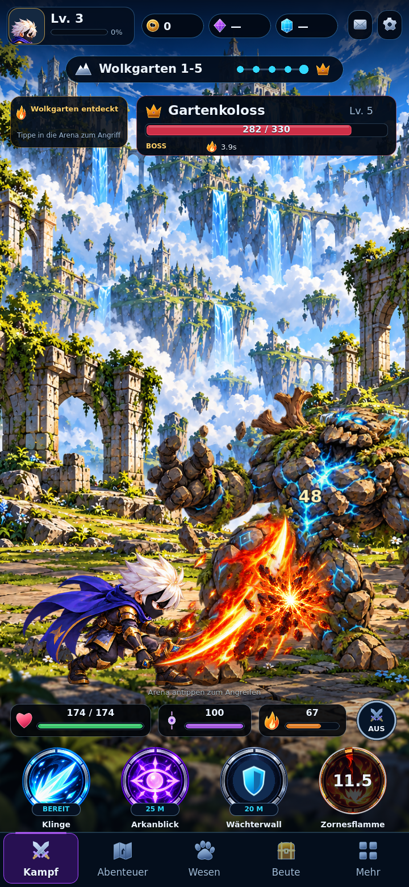
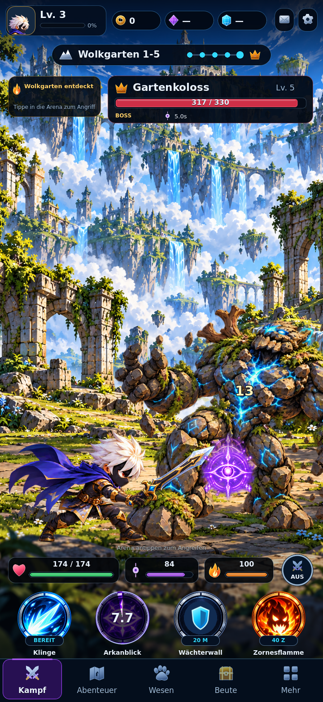
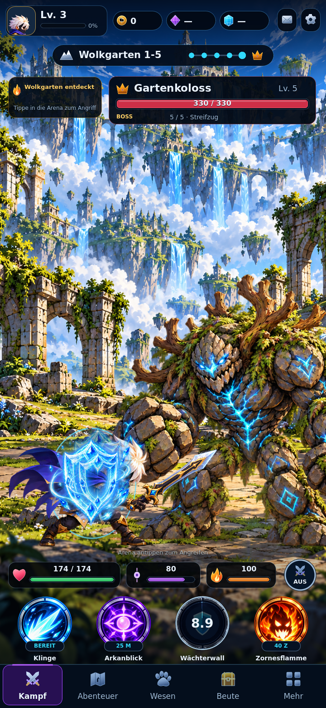

# Work 6.2.1 — Combat presentation

Base: c8377a2 (Work 6.2). New branch: feature/work-6-2-1-full-game-experience. No main or Game Factory writes.

Implemented: absolute blade/finger draw layers with hierarchy-aware UI preview layers; all five blades retain the same authored grip pivot across six canonical poses. AnimationTimeline samples actual action start/windup/recovery values from CombatSession; impacts remain gameplay-driven. Recoil animates motion offsets, preserving layout anchors. Enemy windup precedes the gameplay impact; hit reactions no longer cancel telegraph timing. Heavy boss windups are distinguishable from normal strikes.

CombatVFXController uses eight new transparent, separately catalogued textures. Four skills have charge/cast/transfer/impact/recovery presentations. Mark, burn and shield track actual model states; burn tick/counter/crit effects only follow corresponding events. Spawn, death, reward and level-up effects included. Capacity: 24 transient effects plus one persistent status renderer. Optional effects can be reduced or disabled. Audio has four pooled voices and six project-authored short PCM sounds; sound can be disabled. Preferences are separate from gameplay saves.

Validation so far: existing 283 checks pass; new presentation suite 99/99 passes, including native Godot OpenGL/Mesa rendering. Web/Android CI run 39103254247 passed for runtime 47201f7. Final browser pass and follow-up menu-pause/hitstop export pending. Native captures cover 360x800, 720x1280, 720x1560 and 1280x720; controlled level-3 boss fixtures use the actual catalog HP (330) and model events, not painted damage. Screenshots are lossless WebP engine captures.

Assets: assets/vfx/manifest.json and assets/audio/manifest.json. VFX generated with built-in OpenAI image generation using the supplied combat master as style reference; equal-cell extraction and common transparent padding. Source prompt: create eight isolated blue slash/impact, purple eye/seal, orange slash/impact, cyan shield and gold reward textures on genuine alpha, no characters/text/UI baked in. Audio is deterministic project-authored PCM, seed 621; no third-party recordings.

Scope: A is combat presentation. Premium shared UI/layout is B, expanded authored armor/head/back/evolution is C, world/inventory/quests/content is D. Those milestones must pass their own gates before completion is claimed. Native Android device performance and touch validation require a real device and are not inferred from exports.

Menu navigation now pauses bound actor tweens and VFX processing together with simulation. Hitstop consumes exactly its duration rather than discarding an entire slow frame.

