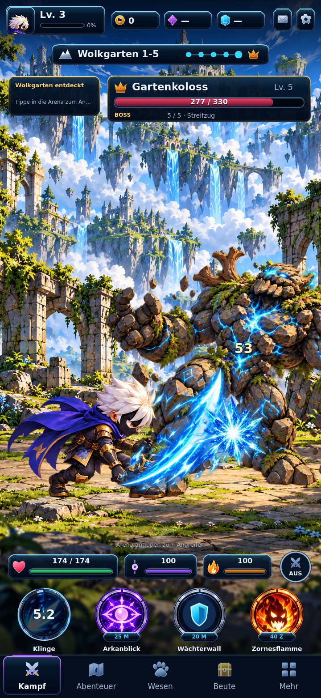
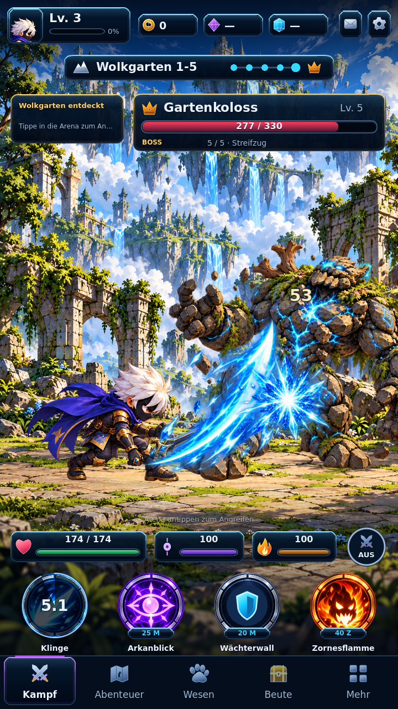
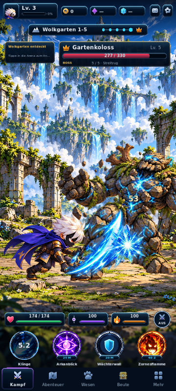
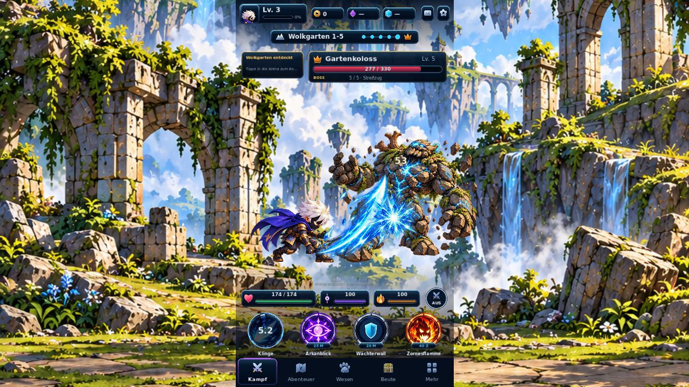
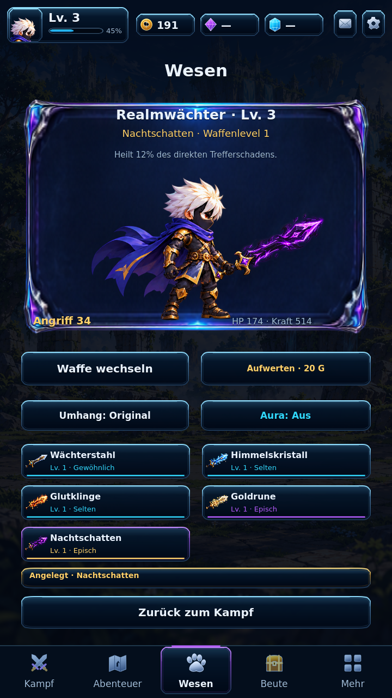
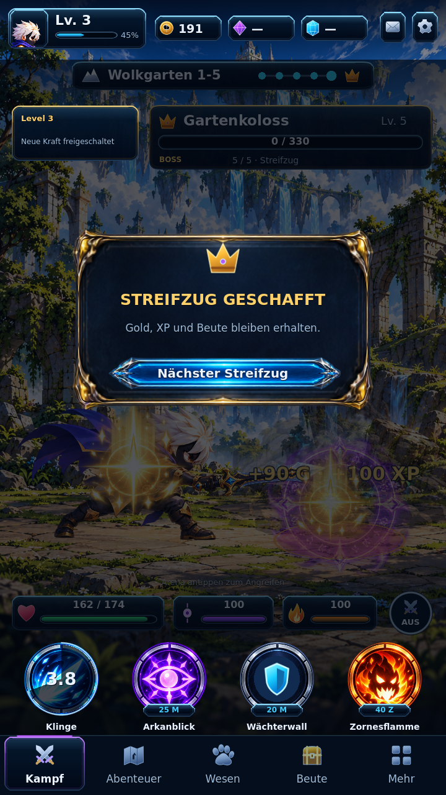
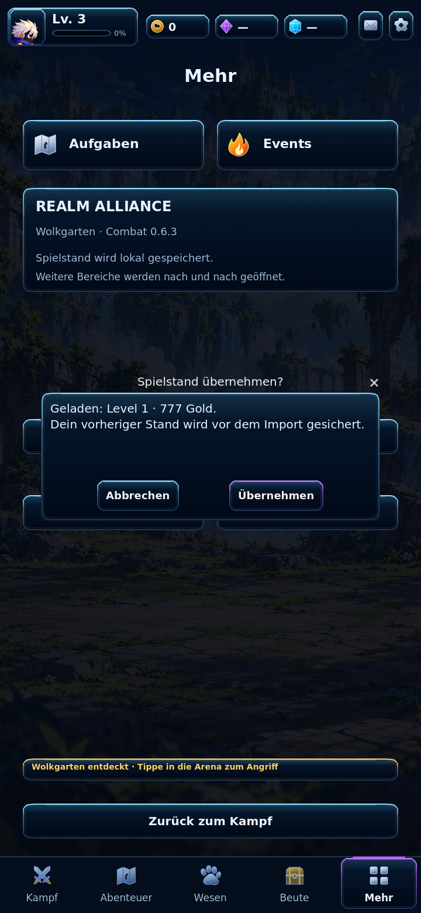

# Work 6.3 — Fantasy UI kit

Runtime commit: `2635cabe696a228c01bb0b5eb3269290ca46bd75`.

## Implemented

- Shared cached texture Theme and StyleBoxTexture materials; compact beveled navy/cyan/gold/violet panels keep small text modules legible. Generated ornate cards are reserved for larger hero/reward surfaces.
- Native reusable FantasyPanel/NinePatchRect, FantasyButton, ResourceBar, EquipmentSlot, SkillOrb, NotificationToast and ModalDialog. The real combat scene, imported-save confirmation and equipment interaction use these components. No full-screen mockup image substitutes for controls.
- Eleven catalogued UI texture assets: six transparent generated raster pieces, five project-authored SVG panel/bar variants. Atlas extraction and alpha/hash provenance are recorded in the asset manifest.
- HP, XP, momentum, rage and enemy health use shared bar materials. Skill components show actual runtime deadlines, costs and unlocks. Equipment cards read owned inventory and correct sword art; loot touch overlays leave underlying item details readable.
- Common ground line and larger tall-phone actors; swords and weapon-following charge effects remain independent. Native import buttons, focus feedback and existing bottom navigation are consistent with the compact theme.
- Audio voices stop and release their stream on scene teardown. UI tests explicitly mute audio to keep shutdown deterministic.

## Validation

- 436/436 deterministic checks across ten suites. Original 387 checks preserved, 49 component/layout contracts added. See tests/*.log.
- Actual Godot 4.7.2 Compatibility renderer captures: 360×800, 720×1280, 720×1560, 1280×720, four skills, hero equipment, inventory, victory and save confirmation. Controlled boss fixture uses the real catalog, model timing and damage events.
- PNG source captures are exported as lossless WebP for repository documentation.
- CI Web/Android export and browser gates are recorded below after completion.

## Scope and limits

- Canonical white-haired masked hero, all five separate swords, Golem/Wolkgarten, Work 6.2 gameplay and V1/V2 save support preserved. Main and Game Factory untouched.
- The original uploaded master-image paths are unavailable in this environment; visual review uses the inherited canonical assets and the explicitly requested navy/cyan/violet/gold hierarchy, not a claimed pixel comparison against those missing files.
- This is the shared kit applied to existing functional pages. Expanded character customization and real quests/world/inventory content remain Work 6.4 and 6.5. No shop/online/fake economy added.
- No physical Android device test or 60 FPS certification is claimed.

## Final gates

[CI 39113001448](https://github.com/Broosskyy/Realm-Alliance/actions/runs/39113001448) succeeded: all ten suites, scene smoke, Web and Android ARM64 exports.

Exported Web build passed: three V1 imports with rapid reload retain gold 777/778/779 and crystal level 3; five-encounter victory; five owned swords; real loot equip; look/aura; settings reload; touch and desktop input. No detected GDScript or page errors. See WEB_VERIFICATION.log.

Active AUTO benchmark: Chromium 151/SwiftShader hosted Linux, default basic AUTO, full effects, no skills, 10.0281 s / 247 rAF frames; median 33.4 ms, p95 66.7 ms. Actual simulation clock advanced and an enemy was defeated, verified through a save exported by UI. Software browser telemetry is not an Android-device result or a 60 FPS guarantee.

APK 0.6.3 / version code 630, same Preview package and development keystore. Both exported APK and ZIP archives validated. User download packages include a launch/install note.

