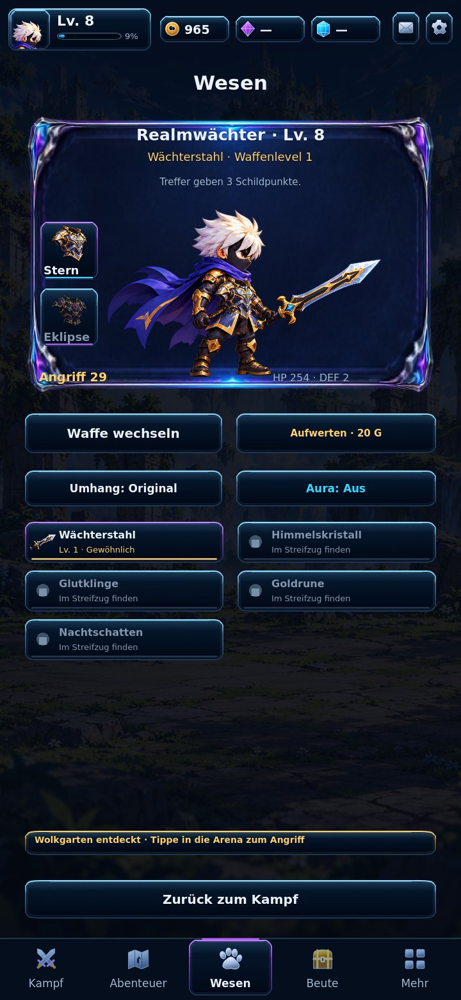
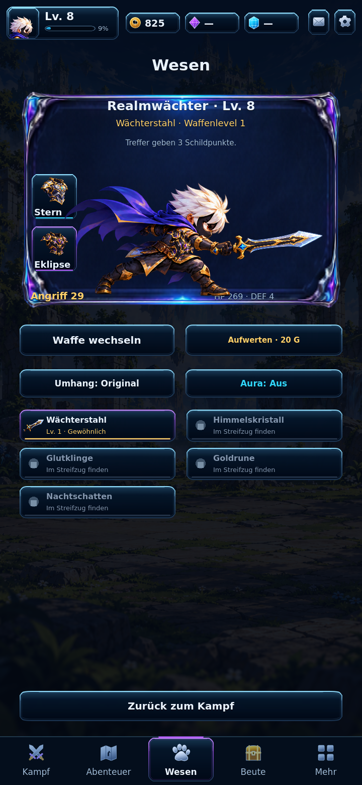
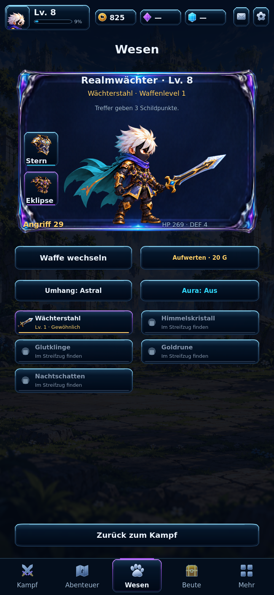
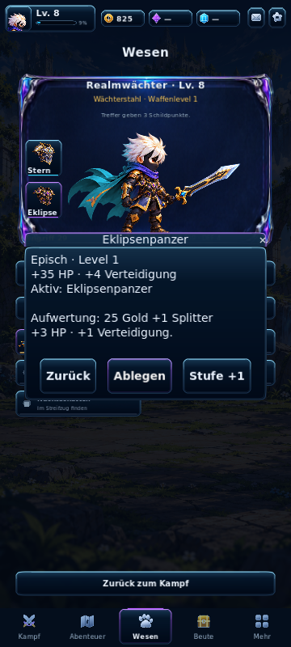

# Work 6.4 — armor vertical slice, in progress

This is a playable implementation checkpoint, not full milestone acceptance. Work 6.3 (`fcf14db0213aaab8ed89caf81a7d8016235aafb8`) remains the last fully accepted gate with Web playtest and Android export. Main and Game Factory unchanged.

## Implemented
- Original master images recovered and reviewed: white hair, black mask, black/gold base and blue/violet cape remain canonical. Multi-page master guides the character layout, not a hero redesign.
- Two isolated armor cutouts, true alpha, stable item IDs and asset hashes. Built-in image generation using canonical idle as perspective/material reference. Prompt: separate fitted celestial silver/navy/gold breastplate with cyan sternum gem; separate higher-rank black/obsidian/violet/gold eclipse breastplate; no hero, weapon, baked effects, UI or text. Meaningful-alpha crop and uniform constrained scale only. Assets/equipment/manifest.json records provenance.
- Optional versioned hero_equipment profile domain, real acquisition costs/unlocks, compatible equip/unequip, upgrades, cosmetic overrides separate from stats. Actual HP and incoming damage use equipment values. Empty domains preserve original balance.
- Shared combat/preview armor rig uses pose-local chest transforms and foreground-arm regions from the exact canonical body texture. Body and all five sword textures remain separate. Armor never replaces the canonical body.
- Wesen slots open real native detail/compare dialogs. Unlock spends gold/shards and equips; equip/unequip and upgrades actually change the saved profile and both visible rigs. Astral is a third functional cape palette.
- Small-screen native dialogs use larger text and 88 logical-pixel buttons; armor targets are 92×92 logical pixels.

## Validation so far
- 516/516 checks across twelve suites: all original 436, 23 equipment model checks and 57 real-scene/attachment/control checks. Includes V1/V2 compatibility, no swap-heal exploit, damage reduction, native purchase/equip/upgrade/unequip, same-pose body/arm regions and >=44 physical-pixel armor targets in all four requested viewport sizes. See tests/.
- Real Godot 4.7.2 Compatibility renders: two armors × six poses, four viewports (360×800, 720×1280, 720×1560, 1280×720), extra Astral palette and 360×800 native dialog. Controlled profile fixture is explicitly seeded to level 8 with sufficient currency, not a fabricated game reward. Lossless WebP examples below.
- Exported Web/browser gates and new Android build are still pending for this preview checkpoint. No Android-device test or performance guarantee claimed.

## Not finished
- Headpiece generation was rejected: gold haze outside the object remains after a cleanup attempt. Neither attempt enters production or the purchasable catalog.
- Head/back sockets are prepared; additional head/back/wing items are not exposed as purchasable or equippable without accepted assets.
- Additional evolution, fuller character/equipment comparison UI, head/back assets and the complete 6.4 gate remain open. Work 6.5 world/inventory/quest/content expansion is not implemented.

